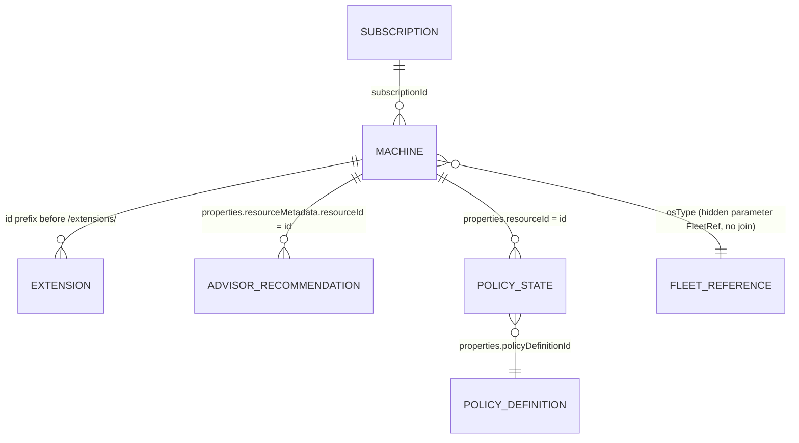

# Azure Arc – Connected Machine Agent Version Compliance (Workbook)

> ⚠️ **Personal, independent project – not an official Microsoft product or documentation.** Provided *as is*, without warranty; see the repository [disclaimer](../../DISCLAIMER.md). Version comparison does **not** determine support. Validate release dates, OS and architecture against the official sources. You are responsible for how you use it.

**Current version: 5.1.0** · **Languages:** English / Português · **Mode:** read-only queries; deploying or saving creates or updates a workbook resource, without upgrading agents or changing the inventoried servers.

[English](README.md) · [Português](README.pt-BR.md) · [Changelog](CHANGELOG.md) · Workbook file: [`arc-agent-support-workbook.json`](../arc-agent-support-workbook.json)

[](https://portal.azure.com/#create/Microsoft.Template/uri/https%3A%2F%2Fraw.githubusercontent.com%2Ffabiotreze%2FAzureArcBRTips%2Fmain%2Ftemplates%2Farc-agent-support-azuredeploy.json)

## What it answers

Azure Monitor workbook for Azure Arc-enabled servers. It answers three questions:

1. How do installed agents compare with the **operational reference and configured minimum**?
2. What evidence exists about **automatic agent upgrade**, connection and last attempt?
3. Which servers and extension diagnostics need review, and what **OS evidence** is reported?

Minor-version distance is an operational comparison, not release age, Microsoft support or security certification. The reference is read live from Azure (auto-upgrade target and the Hybrid Compute exact `latest` endpoint), subject to the explicit manual override below. Downloads use exact versions; download-only overrides do not change comparison. A download or global latest reference does not certify compatibility with an older OS.

**OS coverage:** Inventory shows reported OS name, SKU, version and architecture separately, with a dated summary of **both official OS tables**. This is a reference for manual verification, **not an automatic support classifier**. Incomplete/ambiguous inventory remains not verified. Per the [prerequisites article](https://learn.microsoft.com/azure/azure-arc/servers/prerequisites), OS versions absent from both official tables are unsupported; failure to match a local record does not establish that fact. Ending new agent versions is different from ending servicing: the final compatible agent is serviced for 12 months after its final release. Do not derive an exact end date from the end-of-new-versions month or vendor ESU. AlmaLinux 8 and Oracle Linux 8 have architecture-specific exceptions (ARM64 final 1.69, not an x86-64 cap). Check client-use and ARM64 feature restrictions. Verified on 2026-11-12. For ambiguities or undeclared dates, open a Microsoft support ticket; do not infer an end date.

## Quick path

1. Select subscriptions, language and filters.
2. Open **Overview** and review the servers that need action.
3. Use **Server inventory** and **Automatic agent upgrade** to inspect the evidence.
4. Review **Latest reference & manual upgrade paths**, **Advisor**, **Policy** or **Extensions** as needed.
5. Validate recommendations against official sources before making changes outside the workbook.

## Tabs

| # | Section | What it shows |
|---|---|---|
| 1 | Overview | Connectivity, configured floor, version comparison and upgrade evidence. *At reference* and *Ahead of reference* are distinct in grids; the tile combines them. Disabled with minimum version met remains a recommendation, not an upgrade guarantee |
| 2 | Distribution | Versions, connection status, auto-upgrade health (charts are optional: *Show distribution charts*, off by default) |
| 3 | Azure Advisor | Returned recommendations and later connection-state changes; neither freshness nor resolution is independently established. Counts may overlap |
| 4 | Server inventory | Up to 1000 servers; reported OS name, SKU, version and architecture, plus dated reference tables. OS lifecycle remains not verified |
| 5 | Automatic agent upgrade | Minimum version met (not full eligibility), settings, blockers and last attempt; local prerequisites remain unverified |
| 6 | Latest reference & manual upgrade paths | Reference and exact downloads; aggregated blockers and OS-compatible next steps, without rollout or downgrade recommendations |
| 7 | Azure Policy | Matching policy evaluation results; no results does not prove no assignments |
| 8 | Extensions | Publisher/type/region, exact reported versions, filtered catalog counts and reported diagnostics; no automatic support verdict |

Controls: *Show guide* adds the legend, methodology and official sources. *Show changelog* (Edit mode) shows the editorial history inside the workbook.

Extension catalogs use the merged root array returned by [ARM GETARRAY](https://learn.microsoft.com/azure/azure-monitor/visualize/workbooks-data-sources#azure-resource-manager) (verified on 2026-11-06). If no versions are returned, comparison and upgrade outlook remain unknown; installed-only does not prove a version was withdrawn. Enabled automatic upgrade is not a guarantee of rollout.

### Data model: entities and relationships

Read-only view of what the workbook reads and how the tables are related (derived from the queries in v5.0.0, checked 2026-11-12). Every relationship is a `join` written inside each query; Azure Resource Graph has no stored foreign keys. Property names are validated by the shared contract validator (see Validation).



| Entity | ARG table and type | Key | Joined to | Used by (query) |
|---|---|---|---|---|
| Machine | `resources`, `microsoft.hybridcompute/machines` | `tolower(id)` | all others | all |
| Subscription | `resourcecontainers`, `microsoft.resources/subscriptions` | `subscriptionId` | Machine, left join, only to show the name | `inventory`, `au-detail` |
| Extension | `resources`, `microsoft.hybridcompute/machines/extensions` | machine id = text of `id` before `/extensions/` | Machine, inner join | `extensions`, `ext-available`, `ext-issues` |
| Advisor recommendation | `advisorresources`, `microsoft.advisor/recommendations` | `properties.resourceMetadata.resourceId` | Machine, inner join | `adv-summary`, `adv-detail` |
| Policy state | `policyresources`, `microsoft.policyinsights/policystates` | `properties.resourceId` | Machine, inner join | `policy` |
| Policy definition | `policyresources`, `microsoft.authorization/policydefinitions` | `tolower(id)` = `policyDefinitionId` | Policy state, left join, only for the display name | `policy` |
| Fleet reference | `resources` (machines, aggregated once) | `osType` | hidden parameter `FleetRef`, read by `split`/`toint`, no join | most Machine queries (highest installed, desired and last-attempt version per OS, plus the catalog list; computed once per load instead of once per query) |

Notes: the portal's own Arc lists read `resources` with a type filter and no join; this workbook adds joins to correlate Advisor, Policy and extensions. Up to v5.0.0 each of 16 queries (and the *Latest summary* parameter) ran a self-join over the machines; v5.1.0 replaces it with the `FleetRef` parameter (see Performance below). Learn limits (checked 2026-11-12): at most 3 `join`/`union` per query, and only one cross-table join unless all are Resources with ResourceContainers; see [Resource Graph query language](https://learn.microsoft.com/azure/governance/resource-graph/concepts/query-language).
## Requirements

Reader on the selected subscriptions / management group is required to query data. Deploying the ARM template or saving the workbook requires additional permissions to deploy/create or update the workbook resource. For query validation, use PowerShell 7+ and Az.Accounts.

### Filters and controls (visible parameters)

| Parameter | Default | Meaning |
|---|---|---|
| Subscriptions | All | Subscriptions queried (Azure Resource Graph) |
| Language | EN | Single EN / PT switch for every text in the workbook |
| OsFilter (OS) | All | Operating systems found in the selected subscriptions |
| StatusFilter (Connection Status) | All | Connection statuses found in the selected subscriptions |
| SupportFilter (Version comparison) | All | At reference / Ahead of reference / Within configured window / Outside configured window / Unknown; internal name retained for compatibility |
| AutoUpgradeFilter (Auto Upgrade) | All | Enabled / Disabled / N/A |
| ShowInfo (Show guide) | No | Legend, methodology and official sources |
| ShowCharts (Show distribution charts) | No | Optional charts on Distribution; opening the tab runs 6 extra queries |
| ShowChangelog | No | Editorial history (Edit mode only) |

The remaining parameters are hidden: the *Rules* below, the Azure API versions (`ApiVersion`, `ExtApiVersion`) and values resolved from Azure (`ReleasedWindows`, `ReleasedLinux`, `LatestSummary`, `AnyOsTarget`, `SelectedTab`). On the Extensions tab, selecting a row of the first grid exports `ExtPublisher`, `ExtType` and `ExtLocation` to the comparison grids.

The [regional metadata API](https://learn.microsoft.com/rest/api/hybridcompute/extension-metadata-v-2/list) documents the tenant-level path used here, without `/subscriptions/{id}` (verified on 2026-11-12). Results apply to the selected publisher, type and region, not a universal extension OS matrix.

### Rules (editable in Edit mode)

| Parameter | Default | Meaning |
|---|---|---|
| SupportWindow | 12 minor versions | Operational distance only, **not months or support**. The [release notes](https://learn.microsoft.com/azure/azure-arc/servers/agent-release-notes) state the general last-year policy; the [OS deprecation policy](https://learn.microsoft.com/azure/azure-arc/servers/prerequisites#azure-connected-machine-agent-os-support-and-deprecation) separately covers final compatible agents. Verified on 2026-11-12 |
| AutoUpgradeTolerance | 1 | Heuristic, not a documented guarantee (Microsoft rolls automatic upgrades out in batches and retries failures); *On track* also requires connectivity and no failed last attempt |
| MinAutoUpgradeVersion | 1.67 | Minimum version only. Other requirements: Windows RemoteSigned, Linux cron installed/running, public Azure cloud. Local `automaticupgrade.blocklocally` takes precedence over Azure enablement. These local conditions are not validated here. [Learn](https://learn.microsoft.com/azure/azure-arc/servers/automatic-agent-upgrade), verified on 2026-11-12 |
| **SecurityFloorVersion** | **1.61** | Configurable cross-OS operational threshold, not a vulnerability detector. [CVE-2026-26117](https://www.cve.org/CVERecord?id=CVE-2026-26117) (<1.61) and [CVE-2025-49692](https://www.cve.org/CVERecord?id=CVE-2025-49692) (<1.49) describe Windows; do not infer Linux exposure. [CVE-2025-26627](https://www.cve.org/CVERecord?id=CVE-2025-26627) concerns Installer (<1.0.10), a different component/version. Review new fixes; meeting this floor does not certify security. Records checked on 2026-11-12 |
| LatestOverride | empty | Optional manual reference taken from the agent release notes. When filled it takes priority over every other source (it is not a maximum), even if Azure reports a higher version: update or clear it after each release |

Without an override, *Latest* is the highest reported reference, including the optional fleet maximum. A missing per-OS upgrade target can use the other OS target, identified in `LatestSource`; this is not package compatibility evidence. Azure references can lag release notes. The download selector defaults to the API-confirmed version; confirm OS/architecture compatibility before installation.

## Import

- **Deploy to Azure** button above → pick subscription / resource group → open in *Azure Monitor → Workbooks*.
- **Azure CLI**: `az deployment group create -g <resource-group> --template-uri https://raw.githubusercontent.com/fabiotreze/AzureArcBRTips/main/templates/arc-agent-support-azuredeploy.json`
- **Manual**: Workbooks → New → *Advanced Editor* (`</>`) → paste [`arc-agent-support-workbook.json`](../arc-agent-support-workbook.json) → Apply → Save.

For an **update**, reuse the existing GUID with `--parameters workbookId=<existing-workbook-guid>` in the CLI command. Omitting it evaluates `newGuid()` again and creates another workbook. For reproducible deployments, replace `main` in the template URL with the reviewed commit SHA. Export the existing resource before updating; retain that backup for rollback. See [ARM newGuid behavior](https://learn.microsoft.com/azure/azure-resource-manager/templates/template-functions-string#newguid) (verified on 2026-11-06).

For publication, follow the [revision tracking workflow](CHANGELOG.md#azure-revision-tracking). Record the currently published Azure revision in the new editorial row **before** saving; Azure generates the next revision automatically. GitHub publication alone does not update a deployed workbook.

## Validation

**v5.0.0, verified on 2026-11-12:** 51 offline mock tests, workbook invariants and 16 contract unit assertions passed; 73 anonymous live semantic cases passed. In one existing authenticated subscription (28 machines), EN and PT each produced **719 successful query records** (70 exact-query cache hits), including 375 extension-target cases per language. DryRun: 22 records per language with charts; Burst: 24 successful records per language, with HTTP 429 retries recovered. Agent metadata contract: 0 FAIL, 0 WARN, 0 UNVERIFIED, 27 DOCUMENTED, 388 OK/FREEFORM. JSON, template parity, versions, parameters, encoding and links checked. Portal rendering/clicks and the full Cartesian filter space remain unverified. Query tests used the existing Az.Accounts context; interactive portal authentication is unavailable.

**v5.1.0, verified on 2026-11-12 (Performance).** The per-query self-join by `osType` is replaced by the hidden `FleetRef` parameter (one query per load). Measured with the read-only benchmark on one authenticated tenant scope of 13,860 machines (wall-clock, includes network; Resource Graph does not expose server time): in v5.0.0 the 16 join-based queries took 1.0-1.4 s each (`inventory` 2.6 s); the same queries with the join replaced by constants took 0.3-0.5 s (a lower bound, not an equivalent result). The v5.1.0 timing at that scale has **not been measured yet**. Equivalence on a 612-machine scope: 16 of 17 queries returned identical rows; `inventory` differs only in the order of the concatenated `AdvisorRecommendations` text (`make_set` order is not deterministic; two v5.0.0 runs also differ). 51 offline mock tests passed; DryRun EN/PT passed; live default EN, PT and Burst returned 18 records each with no HTTP 429 (one transient HTTP 404 on the exact Linux download lookup did not repeat on rerun and is unrelated to this change). Portal rendering time and clicks in PT and EN remain unverified.

The shared contract validator previously reported 15 FAIL and 5 WARN in SQL PAYG. They were validator limits, not workbook changes: `resourcechanges` queries were compared with the changed resource's REST schema, and three defensive literals (`Unknown`, `NotSet`, `Active`) are not in the spec enums. The validator now checks the target types against the Learn list, reports the change-record properties and those literals as UNVERIFIED, and the repository-wide run (2026-11-12) gives 0 FAIL, 0 WARN, 9 UNVERIFIED and 40 DOCUMENTED. DOCUMENTED means the property is described by Learn, a REST spec or an Azure Policy alias outside the compared specs (Advisor, Policy, `resourcechanges` record, subscription `quotaId`, VM `hardwareProfile.vmSize`); it is not an OK. The 9 UNVERIFIED are free-form SQL extension `settings.*` paths and defensive literals; the Azure Policy aliases for `Microsoft.HybridCompute/machines/extensions` list only the generic `settings` object, with no inner keys (Get-AzPolicyAlias, 2026-11-12). The validator prints observations for them (for example `enableExtendedSecurityUpdates` and `ConsentToRecurringPAYG.Consented` were populated in 0 of 1310 SQL extensions in 2 scopes, and the paths are read by a third-party public script, not a Microsoft source). Formal confirmation is deferred to Microsoft support. Verified on 2026-11-12; this is not proof that every project is correct. Read-only ARG counts in one large tenant (about 390k Advisor recommendations, 220k policy states, 4.6M change records, 235 subscriptions, 1534 VMs) found the DOCUMENTED fields populated and these values: Advisor `impact` High/Medium/Low and `category` Cost/HighAvailability/OperationalExcellence/Performance/Security; policy `complianceState` NonCompliant/Compliant/Exempt/Unknown (the workbook counts Exempt and Unknown as "other", not as compliant); `changeType` Create/Update/Delete; `hardwareProfile.vmSize` populated on every VM. These are observations, not a Microsoft contract for the value lists.

**SDK cross-check (2026-11-12).** The Azure SDK for Python reference on Learn (azure-mgmt-hybridcompute, page updated 2026-08-17) lists the machine fields read by this workbook (`agentVersion`, `status`, `lastStatusChange`, `osType`, `agentUpgrade`), the `AgentUpgrade` fields (`desiredVersion`, `enableAutomaticUpgrade`, `lastAttemptDesiredVersion`; also `lastAttemptStatus` with known values Success and Failed) and the extension fields (`publisher`, `type`, `typeHandlerVersion`, `enableAutomaticUpgrade`, `instanceView`; `autoUpgradeMinorVersion` is a separate property). Machine `status` known values in that reference are Connected, Disconnected, Error and AwaitingConnection; Expired is not listed there, but the Learn Overview page (Agent status) mentions it, and it was observed in a large tenant. The SDK defines `settings` as a free-form dictionary, so it does not confirm the SQL `settings.*` keys. The SDK describes names and types, not the meaning of each status value; ask Microsoft support about meanings and the Expired gap.

[`scripts/Test-ArcWorkbookQueries.ps1`](../../scripts/Test-ArcWorkbookQueries.ps1) resolves the workbook's supported parameter types and runs visible queries across all tabs against your tenant (read-only). It evaluates inherited group visibility and reports status, rows, duration, HTTP 429 throttling and incomplete results. It uses the ARG REST response to inspect pagination metadata. This is not a replacement for clicking through the portal. Run from the repository root:

```powershell
# Use an existing authenticated Az.Accounts context; these tests do not start interactive login.
# offline lint (no Azure call)
./scripts/Test-ArcWorkbookQueries.ps1 -WorkbookPath ./workbooks/arc-agent-support-workbook.json -DryRun
# every filter value one at a time + the first 3 extension drill-downs
./scripts/Test-ArcWorkbookQueries.ps1 -WorkbookPath ./workbooks/arc-agent-support-workbook.json -Language EN -FilterCombos OneFactor -ExtensionDrill 3
# open each tab like the portal (all its queries at once) with the optional charts on – reproduces HTTP 429
./scripts/Test-ArcWorkbookQueries.ps1 -WorkbookPath ./workbooks/arc-agent-support-workbook.json -Burst -SetParam @{ ShowCharts = 'Yes' }
# all non-empty filter subsets and explicit All selections; identical expanded queries run once per invocation
./scripts/Test-ArcWorkbookQueries.ps1 -WorkbookPath ./workbooks/arc-agent-support-workbook.json -Subscriptions <subscription-id> -Language EN -FilterCombos Subsets -CacheQueries -SetParam @{ ShowCharts = 'Yes' }
# every extension-region row and every published version offered by its comparison table
./scripts/Test-ArcWorkbookQueries.ps1 -WorkbookPath ./workbooks/arc-agent-support-workbook.json -Subscriptions <subscription-id> -Language PT -ExtensionDrill 10000 -AllExtensionTargets -CacheQueries
# anonymous semantic regressions extracted from the actual workbook queries (existing context)
./scripts/Test-ArcAgentSemantics.ps1
```

Results go to `./workbook-test-results` (excluded by `.gitignore`). With the charts on, the Overview tab runs 10 Resource Graph queries at once; the script retries an occasional HTTP 429 automatically.

Repeat the tests in **both EN and PT**. `Subsets` covers the enumerated filter options available in that run, not arbitrary future options or every text input. Test editable text parameters separately with documented boundary cases. `CacheHit=True` identifies reuse of the exact expanded query and subscription scope within one run; do not use caching to measure repeated-request latency or throttling. Burst never uses that cache.

`-SetParam` values take effect before dependent parameters are resolved. Query failures, unresolved tokens, parameter failures and **INCOMPLETE** results produce exit code **1**; success produces **0**. Missing continuation tokens do not prove completeness. Exactly 10,000 rows are complete only when response metadata confirms there are no more. Parameter failures appear in the CSV and the red final summary. Run the offline mock regression tests with `pwsh -NoProfile -File .\scripts\Test-ArcWorkbookQueries.Tests.ps1`.

**Metadata contract check (not a result test).** `pwsh -NoProfile -File .\scripts\Test-ArcWorkbookContract.ps1` compares property paths (including simple root aliases such as `p = properties`), resource types, tables and ARM paths with public REST specs and Learn. `-Live` measures field population, read-only. Freeform fields such as `detectedProperties.architecture` are not a validated support schema. Advisor, Policy and subscription properties without a compared spec remain UNVERIFIED. Offline tests: `Test-ArcWorkbookContract.Tests.ps1`. The separate [semantic fixtures](../../scripts/Test-ArcAgentSemantics.ps1) exercise actual query blocks with anonymous data; mocks alone do not validate KQL semantics.

During normal execution, parameters awaiting only values exported by query row selection are reported as **Skipped (aguarda seleção)** in the CSV and summary, without failing the run. Export names are discovered from query metadata. `-ExtensionDrill` supplies selection values and validates the parameter queries; a real failure or an unresolved non-selection token still produces exit code **1**.

> Test reports contain environment data – treat them as confidential and never attach them to issues or commits.

## Official documentation

- [Manage Azure Connected Machine agent versions](https://learn.microsoft.com/azure/azure-arc/servers/manage-agent) · [Resolve Advisor recommendations for Arc-enabled servers](https://learn.microsoft.com/azure/azure-arc/servers/resolve-azure-advisor-recommendations)
- [Agent release notes](https://learn.microsoft.com/azure/azure-arc/servers/agent-release-notes)
- [OS prerequisites and both lifecycle tables](https://learn.microsoft.com/azure/azure-arc/servers/prerequisites) · [Automatic agent upgrade](https://learn.microsoft.com/azure/azure-arc/servers/automatic-agent-upgrade)
- [Extension management and individual extension documentation](https://learn.microsoft.com/azure/azure-arc/servers/manage-vm-extensions)

## Known limits

Agent references use exact `latest` lookups, and agent downloads use an exact `major.minor` version. Leave the download-only override empty to use the current reference; an unavailable version produces an API error. Extension catalogs use ARM `GETARRAY` to follow continuation links, as [documented for workbook ARM sources](https://learn.microsoft.com/azure/azure-monitor/visualize/workbooks-data-sources#azure-resource-manager). Extension comparisons retain the selected region, matching the [regional metadata API](https://learn.microsoft.com/rest/api/hybridcompute/extension-metadata-v-2/list). Verified on 2026-11-06. Grids remain limited to 1,000 rows where configured; they are not an unlimited fleet export.

Extension diagnostics recognize `healthIssues`, `SystemErrors` and `Not Protected`/nonempty `Errors` in `InstancesStatus`, including JSON surrounded by plain text. Unknown or unparsed messages require review; `Not assessed` is not healthy or supported. Raw status messages remain in per-server details. This is not a universal extension health parser. No catalog result proves retirement. `DaysInStatus`/`DaysInCurrentState` means time since the last state change, not total disconnected duration for Expired servers. Portal rendering/clicks and the full Cartesian filter space remain unverified.

## Maintenance

After each agent release, check [release notes](https://learn.microsoft.com/azure/azure-arc/servers/agent-release-notes), update or clear `LatestOverride`, and reverify the dated OS reference tables against the article. The workbook does not maintain a complete release-date catalog.

## Related projects

- [Arc Posture Review](https://github.com/fabiotreze/arc-posture-review) – point-in-time security assessment; this workbook is the continuous view of the agent/extension part.

See [CHANGELOG](CHANGELOG.md).
