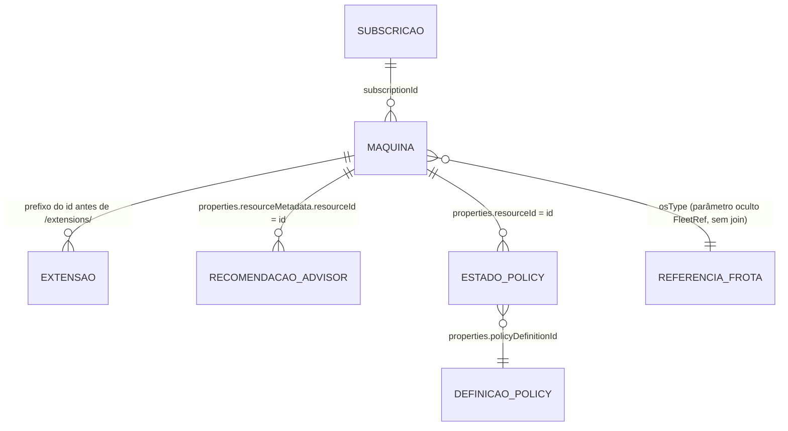

# Azure Arc – Conformidade de versão do Connected Machine Agent (Workbook)

> ⚠️ **Projeto pessoal e independente – não é produto nem documentação oficial da Microsoft.** Fornecido no estado em que se encontra, sem garantia; veja o [aviso legal](../../DISCLAIMER.md#aviso-legal). Comparação de versão **não** determina suporte. Valide datas, SO e arquitetura nas fontes oficiais. O uso é de sua responsabilidade.

**Versão atual: 5.1.5** · **Idiomas:** English / Português · **Modo:** consultas somente leitura; implantar ou salvar cria ou atualiza um recurso de workbook, sem atualizar agents ou alterar os servidores inventariados.

[English](README.md) · [Português](README.pt-BR.md) · [Changelog](CHANGELOG.md) · Arquivo do workbook: [`arc-agent-support-workbook.json`](../arc-agent-support-workbook.json)

[](https://portal.azure.com/#create/Microsoft.Template/uri/https%3A%2F%2Fraw.githubusercontent.com%2Ffabiotreze%2FAzureArcBRTips%2Fmain%2Ftemplates%2Farc-agent-support-azuredeploy.json)

## O que ele responde

Workbook do Azure Monitor para servidores habilitados pelo Azure Arc. Responde três perguntas:

1. Como os agents instalados se comparam à **referência operacional e ao mínimo configurado**?
2. Quais evidências existem sobre **upgrade automático**, conexão e última tentativa?
3. Quais servidores e diagnósticos de extensões precisam de revisão e quais **evidências de SO** são reportadas?

A distância de versões menores é comparação operacional, não idade da release, suporte Microsoft ou atestado de segurança. A referência é lida do Azure (alvo do upgrade automático e endpoint exato `latest` do Hybrid Compute), respeitando o override manual explícito. Downloads usam versão exata; overrides exclusivos de download não alteram a comparação. Download ou latest global não certifica compatibilidade com SO antigo.

**Cobertura de SO:** o Inventário mostra nome, SKU, versão e arquitetura reportados separadamente, com resumo datado das **duas tabelas oficiais de SO**. É referência para validação manual, **não classificador automático de suporte**. Inventário incompleto/ambíguo permanece não verificado. Segundo o [artigo de pré-requisitos](https://learn.microsoft.com/azure/azure-arc/servers/prerequisites), versões de SO ausentes das duas tabelas oficiais não são suportadas; ausência de correspondência local não comprova esse fato. Término de novas versões não é término de manutenção: o agent final compatível recebe manutenção por 12 meses após sua release final. Não derive data exata do mês de término de novas versões ou do ESU do fornecedor. AlmaLinux 8 e Oracle Linux 8 têm exceções por arquitetura (ARM64 com final 1.69, não limite de x86-64). Confira restrições de uso cliente e recursos ARM64. Verificado em 2026-11-12. Para ambiguidades ou datas não declaradas, abra chamado com o suporte Microsoft; não infira o término.

## Caminho rápido

1. Selecione assinaturas, idioma e filtros.
2. Abra **Visão geral** e revise os servidores que precisam de ação.
3. Use **Inventário** e **Upgrade automático** para examinar as evidências.
4. Revise **Referência de latest e upgrade manual**, **Advisor**, **Policy** ou **Extensões** conforme necessário.
5. Valide as recomendações nas fontes oficiais antes de fazer alterações fora do workbook.

## Abas

| # | Seção | O que mostra |
|---|---|---|
| 1 | Visão geral | Conexão, piso configurado, comparação de versão e evidências de upgrade. *At reference* e *Ahead of reference* são distintos nas grades e combinados no tile. Desativado com mínimo atendido permanece recomendação, não garantia de upgrade |
| 2 | Distribuição | Versões, status de conexão, saúde do upgrade automático (gráficos opcionais: *Mostrar gráficos de distribuição*, desligado por padrão) |
| 3 | Azure Advisor | Recomendações retornadas e mudanças posteriores de conexão; não comprova atualidade nem resolução. Contagens podem se sobrepor |
| 4 | Inventário | Até 1000 servidores; nome, SKU, versão e arquitetura de SO reportados e tabelas de referência datadas. Ciclo de SO permanece não verificado |
| 5 | Upgrade automático | Mínimo de versão atendido (não elegibilidade completa), configuração, bloqueios e última tentativa; requisitos locais não verificados |
| 6 | Referência de latest e upgrade manual | Referência, downloads exatos e bloqueios agregados com próximos passos compatíveis com SO, sem garantir rollout ou recomendar downgrade |
| 7 | Azure Policy | Avaliações correspondentes; ausência de resultados não comprova ausência de atribuições |
| 8 | Extensões | Publisher/tipo/região, versões reportadas exatas, contagens filtradas e diagnósticos reportados; sem veredito automático de suporte |

Controles: *Mostrar guia* exibe a legenda, a metodologia e as fontes oficiais. *Exibir histórico* (modo Edit) mostra o histórico editorial dentro do workbook.

Os catálogos de extensões usam o array raiz combinado retornado por [ARM GETARRAY](https://learn.microsoft.com/azure/azure-monitor/visualize/workbooks-data-sources#azure-resource-manager) (verificado em 2026-11-06). Sem versões retornadas, a comparação e a previsão de upgrade permanecem desconhecidas; installed-only não prova que uma versão foi retirada. Upgrade automático habilitado não garante rollout.

### Modelo de dados: entidades e relacionamentos

Visão somente leitura do que o workbook lê e de como as tabelas se relacionam (derivada das queries da v5.0.0, conferida em 12/11/2026). Cada relacionamento é um `join` escrito dentro de cada query; o Azure Resource Graph não tem chaves estrangeiras armazenadas. Os nomes das propriedades são validados pelo validador de contrato compartilhado (ver Validação).



| Entidade | Tabela e tipo no ARG | Chave | Ligada a | Usada por (query) |
|---|---|---|---|---|
| Máquina | `resources`, `microsoft.hybridcompute/machines` | `tolower(id)` | todas as outras | todas |
| Subscrição | `resourcecontainers`, `microsoft.resources/subscriptions` | `subscriptionId` | Máquina, left join, só para exibir o nome | `inventory`, `au-detail` |
| Extensão | `resources`, `microsoft.hybridcompute/machines/extensions` | id da máquina = texto do `id` antes de `/extensions/` | Máquina, inner join | `extensions`, `ext-available`, `ext-issues` |
| Recomendação do Advisor | `advisorresources`, `microsoft.advisor/recommendations` | `properties.resourceMetadata.resourceId` | Máquina, inner join | `adv-summary`, `adv-detail` |
| Estado de Policy | `policyresources`, `microsoft.policyinsights/policystates` | `properties.resourceId` | Máquina, inner join | `policy` |
| Definição de Policy | `policyresources`, `microsoft.authorization/policydefinitions` | `tolower(id)` = `policyDefinitionId` | Estado de Policy, left join, só para o nome de exibição | `policy` |
| Referência da frota | `resources` (máquinas, agregadas uma vez) | `osType` | parâmetro oculto `FleetRef`, lido com `split`/`toint`, sem join | a maioria das queries de Máquina (maior versão instalada, desejada e da última tentativa por SO, mais a lista do catálogo; calculado uma vez por carga, não por query) |

Observações: as listas Arc do próprio portal leem `resources` com filtro de tipo e sem join; este workbook adiciona joins para correlacionar Advisor, Policy e extensões. Até a v5.0.0, 16 queries (e o parâmetro *Latest summary*) faziam um self-join sobre as máquinas; a v5.1.0 o substitui pelo parâmetro `FleetRef` (ver Desempenho abaixo). Limites do Learn (conferidos em 12/11/2026): no máximo 3 `join`/`union` por query, e só um join entre tabelas diferentes, salvo se todos forem Resources com ResourceContainers; ver [linguagem de consulta do Resource Graph](https://learn.microsoft.com/azure/governance/resource-graph/concepts/query-language).
## Requisitos

Reader nas assinaturas / management group selecionados é necessário para consultar os dados. Implantar o template ARM ou salvar o workbook exige permissões adicionais para implantar/criar ou atualizar o recurso de workbook. Para validar as consultas, use PowerShell 7+ e Az.Accounts.

### Filtros e controles (parâmetros visíveis)

| Parâmetro | Padrão | Significado |
|---|---|---|
| Subscriptions | Todas | Assinaturas consultadas (Azure Resource Graph) |
| Language | EN | Seletor único EN / PT para todos os textos do workbook |
| OsFilter (OS) | Todos | Sistemas operacionais encontrados nas assinaturas selecionadas |
| StatusFilter (Connection Status) | Todos | Status de conexão encontrados nas assinaturas selecionadas |
| SupportFilter (Comparação de versão) | Todos | At reference / Ahead of reference / Within configured window / Outside configured window / Unknown; nome interno mantido por compatibilidade |
| AutoUpgradeFilter (Auto Upgrade) | Todos | Enabled / Disabled / N/A |
| ShowInfo (Mostrar guia) | Não | Legenda, metodologia e fontes oficiais |
| ShowCharts (Mostrar gráficos de distribuição) | Não | Gráficos opcionais em Distribuição; abrir a aba executa 6 queries a mais |
| ShowChangelog (Exibir histórico) | Não | Histórico editorial (apenas modo Edit) |

Os demais parâmetros são ocultos: as *Regras* abaixo, as versões de API do Azure (`ApiVersion`, `ExtApiVersion`) e valores resolvidos pelo Azure (`ReleasedWindows`, `ReleasedLinux`, `LatestSummary`, `AnyOsTarget`, `SelectedTab`). Na aba Extensões, selecionar uma linha da primeira grade exporta `ExtPublisher`, `ExtType` e `ExtLocation` para as grades de comparação.

A [API regional de metadados](https://learn.microsoft.com/rest/api/hybridcompute/extension-metadata-v-2/list) documenta o caminho em nível de tenant usado aqui, sem `/subscriptions/{id}` (verificado em 2026-11-12). Os resultados valem para publisher, tipo e região selecionados, não para uma matriz universal de SO das extensões.

### Regras (editáveis no modo Edit)

| Parâmetro | Padrão | Significado |
|---|---|---|
| SupportWindow | 12 versões menores | Apenas distância operacional, **não meses ou suporte**. As [release notes](https://learn.microsoft.com/azure/azure-arc/servers/agent-release-notes) definem a política geral do último ano; a [política de descontinuação de SO](https://learn.microsoft.com/azure/azure-arc/servers/prerequisites#azure-connected-machine-agent-os-support-and-deprecation) cobre separadamente o agent final compatível. Verificado em 2026-11-12 |
| AutoUpgradeTolerance | 1 | Heurística, não uma garantia documentada (a Microsoft libera os upgrades automáticos em lotes e repete as falhas); *On track* também exige conectividade e ausência de falha na última tentativa |
| MinAutoUpgradeVersion | 1.67 | Apenas mínimo de versão. Demais requisitos: RemoteSigned no Windows, cron instalado/executando no Linux, nuvem pública Azure. `automaticupgrade.blocklocally` local prevalece sobre a configuração Azure. Requisitos locais não são validados aqui. [Learn](https://learn.microsoft.com/azure/azure-arc/servers/automatic-agent-upgrade), verificado em 2026-11-12 |
| **SecurityFloorVersion** | **1.61** | Limite operacional configurável aplicado a todos os SOs, não detector de vulnerabilidade. [CVE-2026-26117](https://www.cve.org/CVERecord?id=CVE-2026-26117) (<1.61) e [CVE-2025-49692](https://www.cve.org/CVERecord?id=CVE-2025-49692) (<1.49) descrevem Windows; não inferir exposição Linux. [CVE-2025-26627](https://www.cve.org/CVERecord?id=CVE-2025-26627) refere-se ao Installer (<1.0.10), outro componente/versão. Revise novas correções; atender ao piso não certifica segurança. Registros conferidos em 2026-11-12 |
| LatestOverride | vazio | Referência manual opcional das notas de versão do agent. Quando preenchido, tem prioridade sobre todas as outras fontes (não é um máximo), mesmo que o Azure reporte uma versão maior: atualize ou limpe a cada release |

Sem override, *Latest* é a maior referência reportada, incluindo o máximo opcional da frota. Sem alvo de upgrade por SO, pode usar o alvo do outro SO, identificado em `LatestSource`; não é evidência de compatibilidade de pacote. As referências Azure podem atrasar em relação às release notes. O download usa por padrão a versão confirmada pela API; confirme SO/arquitetura antes de instalar.

## Importação

- Botão **Deploy to Azure** acima → escolha assinatura / resource group → abra em *Azure Monitor → Workbooks*.
- **Azure CLI**: `az deployment group create -g <resource-group> --template-uri https://raw.githubusercontent.com/fabiotreze/AzureArcBRTips/main/templates/arc-agent-support-azuredeploy.json`
- **Manual**: Workbooks → New → *Advanced Editor* (`</>`) → cole [`arc-agent-support-workbook.json`](../arc-agent-support-workbook.json) → Apply → Save.

Para **atualizar**, reutilize o GUID existente com `--parameters workbookId=<existing-workbook-guid>` no comando CLI. Sem ele, `newGuid()` é reavaliado e cria outro workbook. Para uma implantação reproduzível, substitua `main` na URL do template pelo SHA do commit revisado. Exporte o recurso existente antes de atualizar e guarde o backup para rollback. Veja o [comportamento de newGuid no ARM](https://learn.microsoft.com/azure/azure-resource-manager/templates/template-functions-string#newguid) (verificado em 2026-11-06).

Para publicar, siga o [fluxo de registro de revisões](CHANGELOG.md#azure-revision-tracking). Registre a revisão atualmente publicada no Azure na nova linha editorial **antes** de salvar; o Azure gera a próxima revisão automaticamente. Publicar no GitHub, por si só, não atualiza um workbook implantado.

## Validação

**v5.0.0, verificado em 2026-11-12:** passaram 51 testes offline com mocks, invariantes dos workbooks e 16 verificações unitárias de contrato; passaram 73 casos semânticos anônimos no ARG. Em uma assinatura com autenticação existente (28 máquinas), EN e PT produziram **719 registros de queries bem-sucedidos por idioma** (70 reutilizações de query idêntica em cache), incluindo 375 casos de versões-alvo de extensões por idioma. DryRun: 22 registros por idioma com gráficos; Burst: 24 registros bem-sucedidos por idioma, com recuperação dos HTTP 429. Contrato do agent: 0 FAIL, 0 WARN, 0 UNVERIFIED, 27 DOCUMENTED, 388 OK/FREEFORM. JSON, paridade com template, versões, parâmetros, encoding e links conferidos. Renderização/cliques no portal e o espaço cartesiano completo dos filtros permanecem não verificados. Os testes de queries usaram o contexto Az.Accounts existente; autenticação interativa no portal está indisponível.

**v5.1.0, verificado em 2026-11-12 (Desempenho).** O self-join por `osType` em cada query foi substituído pelo parâmetro oculto `FleetRef` (uma query por carga). Medido com o benchmark somente leitura em um escopo autenticado de 13.860 máquinas (tempo de parede, inclui rede; o Resource Graph não expõe tempo de servidor): na v5.0.0 as 16 queries com join levaram 1,0 a 1,4 s cada (`inventory` 2,6 s); as mesmas queries com o join trocado por constantes levaram 0,3 a 0,5 s (limite inferior, não é resultado equivalente). O tempo da v5.1.0 nessa escala **ainda não foi medido**. Equivalência em um escopo de 612 máquinas: 16 de 17 queries devolveram linhas idênticas; `inventory` difere apenas na ordem do texto concatenado de `AdvisorRecommendations` (a ordem de `make_set` não é determinística; duas execuções da v5.0.0 também diferem). Passaram 51 testes offline com mocks; DryRun EN/PT passou; execução real padrão EN, PT e Burst devolveu 18 registros cada, sem HTTP 429 (um HTTP 404 transitório na consulta de download exato do Linux não se repetiu e não tem relação com esta mudança). Tempo de renderização no portal e cliques em PT e EN permanecem não verificados.

**v5.1.1, verificado em 2026-11-13 (Problemas de extensão e abas).** Em um escopo de 612 máquinas, as regras antigas geravam 57 linhas distintas em "Diagnostic review" (197 servidores) porque *Issue* trazia horários, GUIDs, resource IDs e machine IDs; as novas geram 7 linhas para os mesmos servidores e movem para `Not assessed` os servidores que reportam sucesso explícito (agentes do Azure Monitor, MDE.Windows, agente SQL `Healthy` sem falha de plugin no texto, Hybrid Worker, a maioria das extensões de patch). Resumos de operações de patch e mensagens que dizem `failed` permanecem em "Diagnostic review" porque o significado de saúde não está estabelecido. As barras de abas por idioma da v5.1.1 não navegavam ao clicar no portal e foram revertidas na v5.1.2 (veja abaixo). Testes com mocks, DryRun e execuções reais estão listados no commit.

**v5.1.2, 2026-11-13 (Abas).** A barra de abas voltou a ser a barra única bilíngue da v5.1.0 (rótulos como "1-2 Overview / Visão geral"). Dois itens de links com visibilidade condicional em Language não respondiam aos cliques no portal (relatado pelo dono; causa não investigada além disso). Uma invariante offline agora falha se o workbook tiver algo diferente de exatamente uma barra de abas sempre visível. As regras de problemas de extensão da v5.1.1 não mudaram. Cliques em PT e EN nesta versão ainda precisam ser confirmados no portal.

**v5.1.3, verificado em 2026-11-13 (Problemas de extensão).** Uma captura do portal mostrou mensagens da extensão SQL Server que começam com Healthy mas trazem falhas de plugin no mesmo texto (plugin Azure AD com status failed, timeout do Purview, exceção do Purview). A regra da v5.1.1 as classificaria como `Not assessed`; agora são Health warning e *Issue* mostra o detalhe do plugin. Mensagens sem esses marcadores continuam `Not assessed`. Conferido no texto da captura com as mesmas expressões regulares; itens como `AutomaticBackups: Suspended` continuam sem classificação porque o significado não está verificado. Portal não verificado.

**v5.1.5, verificado em 2026-11-13 (Problemas de extensão).** Nova coluna *Last reported by extension (UTC)*: o timestamp mais recente que a própria extensão grava na mensagem de status (`timestampUTC` do agente SQL, `TimestampUTC` do Defender for SQL). Nas amostras do ARG verificadas (`instanceView.status` tem só `level`, `code` e `message`), as demais extensões não trazem data e mostram *Not reported by extension*. O valor é quando a extensão reportou pela última vez, não quando o problema começou. Conferido em mensagens reais em um escopo de 141 assinaturas. Portal não verificado.

**Defender for SQL, instância `Inactive` (verificado em 2026-11-13).** Um *Health warning* como `SQLFCI: Inactive - Failed to initiated all workers` é um estado funcional reportado por instância SQL enquanto o provisioning da extensão está `Succeeded`; não é falha de instalação da extensão. Conforme [Troubleshoot Defender for SQL on Machines](https://learn.microsoft.com/en-us/azure/defender-for-cloud/troubleshoot-sql-machines-guide), o Defender for SQL protege apenas instâncias ativas (em execução), e as ações documentadas por instância são reiniciar o SQL Server, verificar permissões e garantir que a instância esteja ativa. O texto exato `Failed to initiated all workers` não está documentado nessa página, então a causa não está verificada; confirme com o suporte da Microsoft. Não encontrei evidência de que isso afete o Connected Machine agent.

**v5.1.4, verificado em 2026-11-13 (Problemas de extensão).** Para extensões que reportam `InstancesStatus` (por exemplo Defender for SQL), *Issue* agora lista só as instâncias com problema como `instância: status - erros` (por exemplo `MSSQLSERVER: Inactive - Failed to initiated all workers`) em vez do primeiro Status e Errors encontrados, que podia mostrar o status de uma instância diferente da do erro. Conferido em mensagens reais de extensão em um escopo de 612 máquinas. Portal não verificado.

O validador de contrato compartilhado antes apontava 15 FAIL e 5 WARN no SQL PAYG. Eram limites do validador, não mudanças do workbook: as queries de `resourcechanges` eram comparadas com o schema REST do recurso alterado, e três literais defensivos (`Unknown`, `NotSet`, `Active`) não estão nos enums dos specs. Agora o validador confere os tipos-alvo na lista do Learn, reporta as propriedades do registro de mudança e esses literais como UNVERIFIED, e a execução em todo o repositório (12/11/2026) dá 0 FAIL, 0 WARN, 9 UNVERIFIED e 40 DOCUMENTED. DOCUMENTED significa que a propriedade é descrita no Learn, em spec REST ou em alias do Azure Policy fora dos specs comparados (Advisor, Policy, registro de `resourcechanges`, `quotaId` da assinatura, `hardwareProfile.vmSize` da VM); não equivale a OK. Os 9 UNVERIFIED são caminhos livres `settings.*` das extensões SQL e literais defensivos; os aliases do Azure Policy de `Microsoft.HybridCompute/machines/extensions` listam só o objeto genérico `settings`, sem chaves internas (Get-AzPolicyAlias, 12/11/2026). O validador imprime observações (por exemplo, `enableExtendedSecurityUpdates` e `ConsentToRecurringPAYG.Consented` apareceram em 0 de 1310 extensões SQL em 2 escopos, e os caminhos são lidos por script público de terceiros, não por fonte Microsoft). A confirmação formal fica adiada para o suporte Microsoft. Verificado em 12/11/2026; isso não prova que todos os projetos estejam corretos. Contagens somente leitura no ARG em um tenant grande (cerca de 390 mil recomendações do Advisor, 220 mil estados de policy, 4,6 milhões de registros de mudança, 235 assinaturas, 1534 VMs) encontraram os campos DOCUMENTED preenchidos e estes valores: `impact` do Advisor High/Medium/Low e `category` Cost/HighAvailability/OperationalExcellence/Performance/Security; `complianceState` NonCompliant/Compliant/Exempt/Unknown (o workbook conta Exempt e Unknown como "outros", não como conformes); `changeType` Create/Update/Delete; `hardwareProfile.vmSize` preenchido em todas as VMs. São observações, não um contrato da Microsoft para as listas de valores.

**Conferência com o SDK (12/11/2026).** A referência do Azure SDK for Python no Learn (azure-mgmt-hybridcompute, página atualizada em 17/08/2026) lista os campos de máquina lidos por este workbook (`agentVersion`, `status`, `lastStatusChange`, `osType`, `agentUpgrade`), os campos de `AgentUpgrade` (`desiredVersion`, `enableAutomaticUpgrade`, `lastAttemptDesiredVersion`; também `lastAttemptStatus`, com valores conhecidos Success e Failed) e os de extensão (`publisher`, `type`, `typeHandlerVersion`, `enableAutomaticUpgrade`, `instanceView`; `autoUpgradeMinorVersion` é outra propriedade). Os valores conhecidos de `status` nessa referência são Connected, Disconnected, Error e AwaitingConnection; Expired não consta ali, mas a página Overview do Learn (Agent status) o menciona, e ele foi observado em um tenant grande. O SDK define `settings` como dicionário livre, portanto não confirma as chaves `settings.*` do SQL. O SDK descreve nomes e tipos, não o significado de cada valor de status; perguntar ao suporte Microsoft sobre os significados e a ausência de Expired.

[`scripts/Test-ArcWorkbookQueries.ps1`](../../scripts/Test-ArcWorkbookQueries.ps1) resolve os tipos de parâmetros suportados pelo validador e executa as consultas visíveis de todas as abas no seu tenant (somente leitura). Avalia a visibilidade herdada dos grupos e informa status, linhas, duração, HTTP 429 e resultados incompletos. Usa a resposta REST do ARG para conferir metadados de paginação. Não substitui os testes de cliques no portal. Execute a partir da raiz do repositório:

```powershell
# Use contexto Az.Accounts autenticado existente; os testes nao iniciam login interativo.
# lint offline (sem chamada ao Azure)
./scripts/Test-ArcWorkbookQueries.ps1 -WorkbookPath ./workbooks/arc-agent-support-workbook.json -DryRun
# cada valor de filtro isoladamente + os 3 primeiros detalhamentos de extensão
./scripts/Test-ArcWorkbookQueries.ps1 -WorkbookPath ./workbooks/arc-agent-support-workbook.json -Language PT -FilterCombos OneFactor -ExtensionDrill 3
# abre cada aba como o portal (todas as queries ao mesmo tempo) com os gráficos opcionais ligados – reproduz HTTP 429
./scripts/Test-ArcWorkbookQueries.ps1 -WorkbookPath ./workbooks/arc-agent-support-workbook.json -Burst -SetParam @{ ShowCharts = 'Yes' }
# todos os subconjuntos nao vazios dos filtros e a selecao explicita All; consultas identicas executam uma vez por chamada
./scripts/Test-ArcWorkbookQueries.ps1 -WorkbookPath ./workbooks/arc-agent-support-workbook.json -Subscriptions <subscription-id> -Language EN -FilterCombos Subsets -CacheQueries -SetParam @{ ShowCharts = 'Yes' }
# cada linha de extensao/regiao e cada versao publicada oferecida na tabela de comparacao
./scripts/Test-ArcWorkbookQueries.ps1 -WorkbookPath ./workbooks/arc-agent-support-workbook.json -Subscriptions <subscription-id> -Language PT -ExtensionDrill 10000 -AllExtensionTargets -CacheQueries
# regressoes semanticas anonimas extraidas das queries reais (contexto existente)
./scripts/Test-ArcAgentSemantics.ps1
```

Os resultados vão para `./workbook-test-results` (excluído pelo `.gitignore`). Com os gráficos ligados, a aba Visão geral executa 10 queries do Resource Graph ao mesmo tempo; o script repete automaticamente um HTTP 429 ocasional.

Repita os testes em **EN e PT**. `Subsets` cobre as opções enumeradas disponíveis naquela execução, não opções futuras nem todo texto livre. Teste os parâmetros de texto editáveis separadamente, com casos de borda documentados. `CacheHit=True` identifica a reutilização da consulta expandida idêntica e do mesmo escopo de assinaturas na execução; não use cache para medir latência de requisições repetidas nem throttling. Burst nunca utiliza esse cache.

Os valores de `-SetParam` são aplicados antes da resolução dos parâmetros dependentes. Falhas de consulta, tokens não resolvidos, falhas de parâmetro e resultados **INCOMPLETE** produzem código de saída **1**; sucesso produz **0**. A ausência de token de continuação não comprova completude. Exatamente 10.000 linhas só são completas se os metadados confirmarem que não há mais resultados. As falhas de parâmetro aparecem no CSV e no resumo final em vermelho. Execute os testes de regressão offline com mocks usando `pwsh -NoProfile -File .\scripts\Test-ArcWorkbookQueries.Tests.ps1`.

**Verificação de contrato com metadados (não testa resultados).** `pwsh -NoProfile -File .\scripts\Test-ArcWorkbookContract.ps1` compara caminhos de propriedades (incluindo aliases simples como `p = properties`), tipos, tabelas e caminhos ARM com as especificações REST públicas e o Learn. `-Live` mede preenchimento dos campos, somente leitura. Metadados livres como `detectedProperties.architecture` não são esquema validado de suporte. Advisor, Policy e assinatura sem especificação comparada permanecem UNVERIFIED. Testes offline: `Test-ArcWorkbookContract.Tests.ps1`. Os [casos semânticos](../../scripts/Test-ArcAgentSemantics.ps1) exercitam blocos reais das queries com dados anônimos; mocks não validam semântica KQL.

Na execução normal, parâmetros que aguardam apenas valores exportados pela seleção de linha de uma consulta aparecem como **Skipped (aguarda seleção)** no CSV e no resumo, sem reprovar a execução. Os nomes exportados são descobertos pelos metadados das consultas. `-ExtensionDrill` fornece valores de seleção e valida as consultas dos parâmetros; uma falha real ou um token não resolvido que não venha da seleção continua produzindo código de saída **1**.

> Os relatórios de teste contêm dados do ambiente – trate como confidenciais e nunca anexe em issues ou commits.

## Documentação oficial

- [Gerenciar versões do Connected Machine agent](https://learn.microsoft.com/azure/azure-arc/servers/manage-agent) · [Resolver recomendações do Advisor para servidores Arc](https://learn.microsoft.com/azure/azure-arc/servers/resolve-azure-advisor-recommendations)
- [Notas de versão do agent](https://learn.microsoft.com/azure/azure-arc/servers/agent-release-notes)
- [Pré-requisitos de SO e ambas as tabelas de ciclo de vida](https://learn.microsoft.com/azure/azure-arc/servers/prerequisites) · [Upgrade automático do agent](https://learn.microsoft.com/azure/azure-arc/servers/automatic-agent-upgrade)
- [Gerenciamento e documentação individual de extensões](https://learn.microsoft.com/azure/azure-arc/servers/manage-vm-extensions)

## Limites conhecidos

As referências do agent usam consultas exatas a `latest`, e os downloads usam a versão exata `major.minor`. Deixe o override exclusivo de download vazio para usar a referência atual; uma versão indisponível produz erro da API. Os catálogos de extensões usam ARM `GETARRAY` para seguir a continuação, conforme a [documentação das fontes ARM de workbooks](https://learn.microsoft.com/azure/azure-monitor/visualize/workbooks-data-sources#azure-resource-manager). As comparações de extensões preservam a região selecionada, seguindo a [API regional de metadados](https://learn.microsoft.com/rest/api/hybridcompute/extension-metadata-v-2/list). Verificado em 2026-11-06. As grades continuam limitadas a 1.000 linhas onde configurado; não são uma exportação ilimitada da frota.

O diagnóstico reconhece `healthIssues`, `SystemErrors` e `Not Protected`/`Errors` não vazio em `InstancesStatus`, incluindo JSON cercado de texto simples. Desde a v5.1.1 também lê o token `SQL Server Extension Agent: <status>` (qualquer valor diferente de `Healthy`, `uploadStatus` diferente de `OK`, ou um plugin com `"status":"failed"`, timeout ou `Exception:` no mesmo texto é Health warning, mesmo que o token principal diga `Healthy`) e trata como `Not assessed` uma mensagem `Succeeded` que começa com frase explícita de sucesso (por exemplo `Enable succeeded`, `ExtensionOperation:enable. Status:Success`, `Successfully completed`) ou traz `onboardingPackageOperationResultCode: Success`. Essas regras vêm de mensagens observadas em um tenant, não de um catálogo de mensagens da Microsoft (não verificado na documentação). Itens como `AutomaticBackups: Suspended` ou `ESU service is disabled` no texto do agente SQL são estado de configuração e não são tratados como alerta. *Issue* mostra a causa (a lista `healthIssues`, `SystemErrors`, o status e os erros de `InstancesStatus`, ou o início do texto de uma mensagem não reconhecida) sem horários, GUIDs ou números, de modo que servidores com a mesma causa se agrupam. Mensagens desconhecidas ou não interpretadas exigem revisão; `Not assessed` não significa saudável ou suportado. Mensagens brutas permanecem nos detalhes por servidor. Não é parser universal de saúde de extensões. Resultado de catálogo não comprova retirada. `DaysInStatus`/`DaysInCurrentState` é tempo desde a última mudança de estado, não duração total desconectada em servidores Expired. Renderização/cliques no portal e o espaço cartesiano completo dos filtros permanecem não verificados.

## Manutenção

Após cada release do agent, confira as [release notes](https://learn.microsoft.com/azure/azure-arc/servers/agent-release-notes), atualize ou limpe `LatestOverride` e reverifique as tabelas datadas de SO no artigo. O workbook não mantém catálogo completo de datas de releases.

## Projetos relacionados

- [Arc Posture Review](https://github.com/fabiotreze/arc-posture-review) – avaliação de segurança pontual; este workbook é a visão contínua da parte de agent/extensões.

Veja o [CHANGELOG](CHANGELOG.md).
