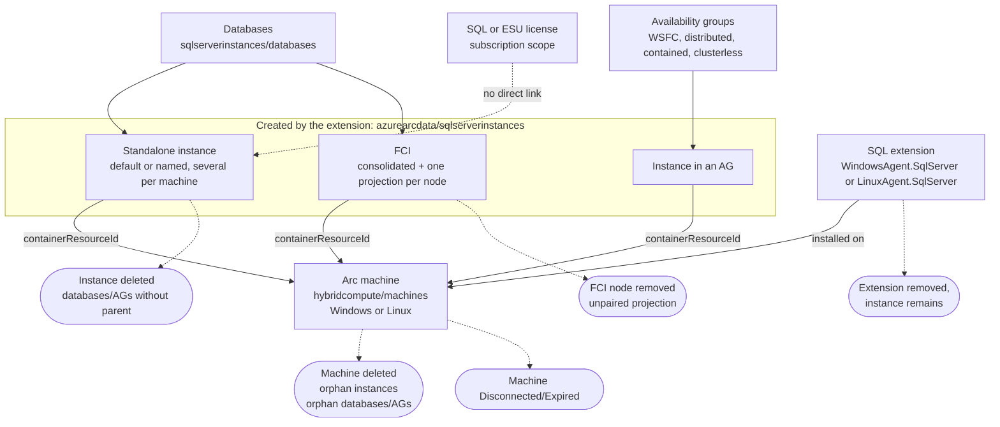

# Azure Arc SQL - Resource Reconciliation Workbook

> Personal, independent project, not an official Microsoft tool. See [DISCLAIMER](../../DISCLAIMER.md). Findings are candidates for investigation, not confirmed orphan resources or licensing noncompliance.

**Current version: 1.2.3** · **Languages:** English / Português · **Mode:** read-only queries. Deploying or saving creates or updates a workbook resource; it does not modify SQL servers or licenses.

[English](README.md) · [Português](README.pt-BR.md) · [Changelog](CHANGELOG.md) · [Workbook JSON](../arc-sql-resource-reconciliation-workbook.json)

[](https://portal.azure.com/#create/Microsoft.Template/uri/https%3A%2F%2Fraw.githubusercontent.com%2Ffabiotreze%2FAzureArcBRTips%2Fmain%2Ftemplates%2Farc-sql-resource-reconciliation-azuredeploy.json)

## What it answers

- Which SQL resources have missing or unexpected container/parent relationships in ARG?
- Which instances belong to a machine that is not Connected, or whose Arc machine has no SQL extension, and which SQL extensions report a non-Healthy status or upload problem?
- Which FCI references or projection metadata require investigation?
- Which availability groups report unhealthy, missing or inconsistent metadata?
- Which license resources have incomplete SQL license metadata or explicitly unfinished provisioning?

Only technical exceptions and inconclusive evidence are displayed. Known Azure VM containers are excluded; a missing parent cannot be assigned conclusively to Arc or Azure VM and remains a candidate. Subscription-level license resources are not joined to individual machines.

## Quick path

1. Import the JSON and select subscriptions and language.
2. Review **Relationships**, **Connectivity**, **FCI**, **Availability Groups** and **Licenses**.
3. Open the **Validation guide** before investigating a finding.
4. Check resource IDs, access and the correct API version, then read the child and parent directly through ARM/the resource provider.
5. Share sanitized portal results for query refinement. Do not share credentials, resource IDs, machine names or environment exports publicly.

## Tabs

| Tab | Exception queries |
|---|---|
| Relationships | SQL container, database/AG parent (including dependents of an instance whose Arc machine is gone), SQL extension parent, databases on a disconnected host or without a Succeeded SQL extension (one row per SQL instance) |
| Connectivity | Instance status other than Connected, SQL extension health/upload errors, instances whose host has no SQL extension |
| FCI | Incomplete projection metadata, unmatched declared hosts, missing referenced instances, inconsistent projection summary, declared hosts without node projection, node projections not declared by the cluster |
| Availability Groups | Missing correlation/health/provisioning metadata, unhealthy states, conflicting projections |
| Licenses | Missing SQL license fields or explicit provisioning other than Succeeded |
| Validation guide | ARG versus direct provider checks; no resource-changing actions |

Resource model used by the queries (ARG resource types; arrows point from child to parent). The workbook reports the gaps in these relationships; it does not create them:



Only the Arc machine plus SQL extension scope is modeled: SQL managed instance, data controller and Kubernetes resources are out of scope.

| Finding query | Checks | Tab |
|---|---|---|
| Instance to container | Missing, unknown or absent container | Relationships |
| Database/AG to instance | Parent instance absent, instance without container, or instance whose Arc machine is absent (transitive orphan) | Relationships |
| Extension to machine | Parent Arc machine absent from ARG | Relationships |
| Database host | Host not Connected or SQL extension absent/not Succeeded | Relationships |
| Instance status | Status other than Connected on an existing Arc machine (inventory timestamp shown for context only) | Connectivity |
| Instance without extension | Instance remains but its existing Arc machine has no SQL extension | Connectivity |
| Extension health | Provisioning not Succeeded, status not Healthy, upload not OK (plugin-level statuses inside a Healthy message are not judged) | Connectivity |
| FCI projections | Incomplete or inconsistent metadata (heuristic) | FCI |
| FCI declared host | Host listed by the consolidated projection without a node projection | FCI |
| FCI node projection | Node projection whose container is not among the declared hosts | FCI |
| AG health | Unhealthy, missing or conflicting metadata | Availability Groups |
| License metadata | Missing fields or provisioning not Succeeded | Licenses |

### Classification and validation outcomes

The workbook shows the initial classification. Direct provider (RP) reads are a manual step in the Validation guide; the workbook does not issue them and never concludes "strong orphan candidate" by itself.

| Discovered scenario | Initial classification | Covered |
|---|---|---|
| SQL instance without `containerResourceId`, unknown container, or container absent from ARG | Review (container absent: RP validation pending) | Yes |
| Database or AG with absent instance | Parent review | Yes, plus dependents of an orphan instance |
| SQL extension with absent machine | Parent review | Yes |
| FCI host declared but absent, or `sqlInstanceId` absent | FCI topology review | Yes |
| FCI without consolidated projection, or without node projection | FCI topology review | Yes (cluster level and per declared host) |
| FCI node and container inconsistent | FCI topology review | Yes (heuristic, host names compared without domain suffix) |
| Several AG projections | Correlate by `availabilityGroupId` | Yes |
| Several FCI projections | Correlate by `failoverCluster.id` | Yes |
| SQL license, physical cores, ESU | Licensing/billing review | Limited: missing metadata or unfinished provisioning only |
| Resource group or subscription move | Relationship review | No: ARG cannot tell a move from an absence |

| Direct provider result | Classification |
|---|---|
| Child exists in ARG, child RP 404 | Stale ARG entry |
| Parent absent in ARG, parent RP 200 | ARG consistency delay |
| Parent RP 404 and child RP 200 | Strong orphan candidate |
| Parent RP 404 and child RP 404 | Stale ARG entry |
| RP 403, timeout or transient failure | Inconclusive |

### Scenario coverage

Status as of 2026-11-06. "Executed" means the query ran without error against a lab subscription; it does not mean the scenario was exercised with real findings. The lab is a reference, not a limit.

| Scenario | Handling | Status |
|---|---|---|
| Instance whose Arc machine was deleted (orphan) | Instance to container; databases/AGs flagged as dependents | Instance case seen in a tester-provided result; dependents not yet observed |
| Windows and Linux SQL extension | Both extension types are matched (names per [Microsoft Learn](https://learn.microsoft.com/sql/sql-server/azure-arc/delete-from-azure-arc), verified 2026-11-06) | Executed; no Linux host observed |
| Several instances on one machine | One row per instance; not an exception by itself | Not tested |
| Instance not Connected | Connectivity tab; documented status example is `Registered`, full list of values not verified. A stale-inventory check was removed in 1.2.2: in a real run, Connected instances on healthy hosts showed old inventory timestamps (cause not verified) | Executed |
| Host disconnected/expired | Database host query | Observed in lab |
| Extension health or upload errors | Matches the observed message format (`Healthy`, `uploadStatus : OK`); format not documented by Microsoft, treat as heuristic | Observed in lab |
| Extension removed, instance remains | Instance without extension | Executed; no positive case observed |
| FCI (consolidated and per-node) | Heuristic projection checks | A declared host without node projection was observed in the lab; other topologies not verified |
| AG: WSFC, distributed, contained, clusterless | AG health query; `isDistributed`, `isContained` and `clusterTypeDescription` exist in the [AG API](https://learn.microsoft.com/rest/api/arcdata/sql-server-availability-groups/get) but are not judged as exceptions | Only the basic WSFC case observed |
| Proxy, Private Link, Arc gateway | Not judged. The host query only exposes whether a proxy URL is configured; Private Link and gateway are not read | Not verified |
| Azure VM with SQL IaaS extension | Excluded by design (Arc only) | Not applicable |
| Log shipping, replication | No Arc resource to reconcile | Out of scope |

## Requirements

Reader access to the selected subscriptions. Parent and child scopes must both be accessible; restricted permissions and missing subscriptions can resemble missing resources. Saving/deploying needs additional workbook resource permissions. Optional local query lint uses PowerShell 7+; live harness execution needs Az.Accounts.

## Import

Azure Monitor → Workbooks → New → **Advanced Editor** → paste the [workbook JSON](../arc-sql-resource-reconciliation-workbook.json) → Apply. Test without saving first. Use the [ARM template](../../templates/arc-sql-resource-reconciliation-azuredeploy.json) for deployment.

For an update, provide the existing workbook GUID instead of the default `newGuid()`, back up the existing resource, and pin remote template URLs to a reviewed commit. The Deploy button references published `main`, not uncommitted local content. See [ARM newGuid](https://learn.microsoft.com/azure/azure-resource-manager/templates/template-functions-string#newguid), verified on 2026-11-06.

## Validation performed

Status as of 2026-11-06. Local: mock tests and workbook invariants pass; the 15 queries run without error (PT and EN, normal and burst) against a lab subscription via the harness. Portal: a tester pasted the rendered **Connectivity** tab (PT and EN, versions 1.2.1 to 1.2.2) and it showed no layout error; that output led to removing the stale-inventory check and the plugin-level extension check. The other tabs, the tab navigation and the Validation guide were **not verified in the portal**. Positive cases for transitive orphans, an extension removed with the instance remaining, and node/container inconsistencies were not observed. No Azure resources were changed.

From the repository root:

```powershell
pwsh -NoProfile -File .\scripts\Test-ArcWorkbookQueries.ps1 -WorkbookPath .\workbooks\arc-sql-resource-reconciliation-workbook.json -DryRun -Language PT
pwsh -NoProfile -File .\scripts\Test-ArcWorkbookQueries.ps1 -WorkbookPath .\workbooks\arc-sql-resource-reconciliation-workbook.json -DryRun -Language EN
```

Portal acceptance checklist:

- Click all six tabs in PT and EN; confirm only the active tab loads queries.
- Validate each of the fifteen queries separately; distinguish an empty result from a query error.
- Use a healthy known case: it must not appear in exception grids.
- Use known missing relationships, incomplete FCI metadata and unhealthy AGs: they must appear.
- Verify matching healthy AG projections with different display names are correlated by ID.
- Verify missing AG IDs remain separate resources.
- Verify complete Paid/PAYG and Activated/Deactivated licenses are not automatically reported.
- Compare child/parent GET results and record whether findings were confirmed, stale or inconclusive.

## Official documentation

Verified on 2026-11-06:

- [ARG query strategy and direct provider validation](https://learn.microsoft.com/azure/governance/resource-graph/choose-query-strategy)
- [SQL Arc FCI inventory and limitations](https://learn.microsoft.com/sql/sql-server/azure-arc/support-for-fci)
- [SQL instance resource API](https://learn.microsoft.com/rest/api/arcdata/sql-server-instances/get)
- [SQL license resource API](https://learn.microsoft.com/rest/api/arcdata/sql-server-licenses/get)
- [ARG supported language](https://learn.microsoft.com/azure/governance/resource-graph/concepts/query-language)

## Known limits

- ARG is eventually consistent. A 404 is inconclusive until resource ID, API version, access and scope are verified. Two successful GETs establish existence, not relationship validity.
- FCI consolidated/node classification uses observed metadata arrays; the expected shape in the target environment is **not verified**. Hostname differences do not prove orphaning. Collection-time differences can produce transient discrepancies.
- AG correlation does not establish replica completeness. No arbitrary inventory-age threshold or expected replica count is imposed.
- Missing SQL license metadata is a review signal; absence of optional provisioningState alone is not an error. ESU entitlement, intended activation and billing are not inferred. ESU rows without explicit provisioning exceptions may return no findings even when further licensing review is needed; use the [PAYG readiness guide](../arc-sql-payg-readiness/README.md).
- Each grid is limited to 1,000 rows. Summaries and expanded references may not support ARG continuation tokens; a successful portal view is not proof of exhaustive export.
- No delete/update commands, remediation buttons or full healthy inventory are included.
