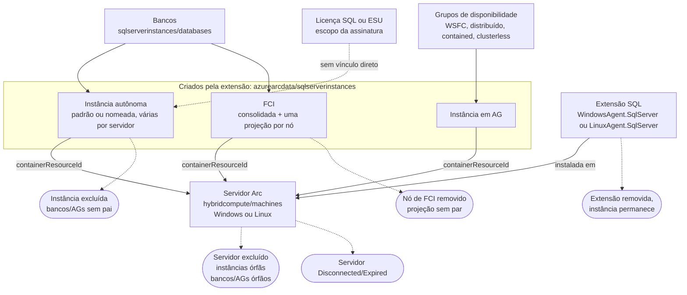

# Azure Arc SQL - Workbook de reconciliação de recursos

> Projeto pessoal e independente, não é ferramenta oficial da Microsoft. Veja [DISCLAIMER](../../DISCLAIMER.md#aviso-legal). Achados são candidatos para investigação, não órfãos confirmados ou irregularidades de licenciamento.

**Versão atual: 1.2.8** · **Idiomas:** English / Português · **Modo:** consultas somente leitura. Implantar ou salvar cria ou atualiza um recurso de workbook; não altera servidores SQL ou licenças.

[English](README.md) · [Português](README.pt-BR.md) · [Changelog](CHANGELOG.md) · [JSON do workbook](../arc-sql-resource-reconciliation-workbook.json)

[](https://portal.azure.com/#create/Microsoft.Template/uri/https%3A%2F%2Fraw.githubusercontent.com%2Ffabiotreze%2FAzureArcBRTips%2Fmain%2Ftemplates%2Farc-sql-resource-reconciliation-azuredeploy.json)

## O que ele responde

- Quais recursos SQL têm relações com contêiner/pai ausentes ou inesperadas no ARG?
- Quais instâncias pertencem a máquina fora de Connected ou a máquina Arc sem extensão SQL, e quais extensões SQL reportam status não Healthy ou falha de upload?
- Quais referências FCI ou metadados de projeção exigem investigação?
- Quais grupos de disponibilidade reportam metadados não saudáveis, ausentes ou inconsistentes?
- Quais recursos de licença têm metadados SQL incompletos ou provisionamento explicitamente não concluído?

Somente exceções técnicas e evidências inconclusivas são exibidas. Contêineres Azure VM conhecidos são excluídos; um pai ausente não pode ser atribuído conclusivamente a Arc ou Azure VM e permanece candidato. Recursos de licença no escopo da assinatura não são associados a máquinas individuais.

## Caminho rápido

1. Importe o JSON e selecione assinaturas e idioma.
2. Revise **Relacionamentos**, **Conectividade**, **FCI**, **Grupos de disponibilidade** e **Licenças**.
3. Abra o **Guia de validação** antes de investigar um achado.
4. Confira IDs, acesso e versão correta da API, depois leia filho e pai diretamente via ARM/provedor.
5. Compartilhe resultados do portal sem dados sensíveis para refinar as consultas. Não publique credenciais, IDs de recursos, nomes de máquinas ou exportações do ambiente.

## Abas

| Aba | Consultas de exceções |
|---|---|
| Relacionamentos | Contêiner SQL, pai de banco/AG (inclui dependentes de instância cuja máquina Arc não existe mais), pai da extensão SQL, bancos em host desconectado ou sem extensão SQL Succeeded (uma linha por instância SQL) |
| Conectividade | Status da instância diferente de Connected, erros de saúde/upload da extensão SQL, instâncias cujo host não tem extensão SQL |
| FCI | Projeção incompleta, hosts declarados sem correspondência, instâncias referenciadas ausentes, resumo divergente, hosts declarados sem projeção de nó, projeções de nó não declaradas pelo cluster |
| Grupos de disponibilidade | Correlação/saúde/provisionamento ausentes, estados não saudáveis, projeções conflitantes |
| Licenças | Campos de licença SQL ausentes ou provisionamento explícito diferente de Succeeded |
| Guia de validação | ARG versus consultas diretas ao provedor; sem ações de alteração |

Modelo de recursos usado pelas consultas (tipos do ARG; setas do filho para o pai). O workbook reporta lacunas nestas relações; não as cria:



Só o escopo servidor Arc mais extensão SQL é modelado: instância gerenciada SQL, controlador de dados e recursos Kubernetes ficam fora.

| Consulta de achado | Verifica | Aba |
|---|---|---|
| Instância para contêiner | Contêiner ausente, desconhecido ou fora do ARG | Relacionamentos |
| Banco/AG para instância | Instância pai ausente, instância sem contêiner ou cuja máquina Arc não existe (órfão transitivo) | Relacionamentos |
| Extensão para máquina | Máquina Arc pai ausente do ARG | Relacionamentos |
| Host dos bancos | Host fora de Connected ou extensão SQL ausente/não Succeeded | Relacionamentos |
| Status da instância | Status diferente de Connected em máquina Arc existente (horário do inventário só como contexto) | Conectividade |
| Instância sem extensão | A instância permanece, mas a máquina Arc existente não tem extensão SQL | Conectividade |
| Saúde da extensão | Provisionamento diferente de Succeeded, sem `SQL Server Extension Agent: Healthy`, sem `uploadStatus : OK`, ou `timestampUTC` fora dos últimos 3 dias ou ausente (status de plugin dentro de mensagem Healthy não é julgado) | Conectividade |
| Projeções FCI | Metadados incompletos ou inconsistentes (heurística) | FCI |
| Host declarado da FCI | Host listado pela projeção consolidada sem projeção de nó | FCI |
| Projeção de nó da FCI | Projeção de nó cujo contêiner não está entre os hosts declarados | FCI |
| Saúde do AG | Metadados não saudáveis, ausentes ou conflitantes | Grupos de disponibilidade |
| Metadados de licença | Campos ausentes ou provisionamento diferente de Succeeded | Licenças |

### Classificação e resultados de validação

O workbook mostra a classificação inicial. A leitura direta no provedor (RP) é uma etapa manual do Guia de validação; o workbook não a executa e nunca conclui "candidato forte a órfão" sozinho.

| Cenário descoberto | Classificação inicial | Coberto |
|---|---|---|
| Instância SQL sem `containerResourceId`, contêiner desconhecido ou ausente do ARG | Revisão (contêiner ausente: validação no RP pendente) | Sim |
| Banco ou AG com instância ausente | Revisão do pai | Sim, mais dependentes de instância órfã |
| Extensão SQL com máquina ausente | Revisão do pai | Sim |
| Host da FCI declarado mas ausente, ou `sqlInstanceId` ausente | Revisão da topologia FCI | Sim |
| FCI sem projeção consolidada ou sem projeção de nó | Revisão da topologia FCI | Sim (nível do cluster e por host declarado) |
| Nó e contêiner da FCI inconsistentes | Revisão da topologia FCI | Sim (heurística, nomes comparados sem sufixo de domínio) |
| Várias projeções de AG | Correlacionar por `availabilityGroupId` | Sim |
| Várias projeções de FCI | Correlacionar por `failoverCluster.id` | Sim |
| Licença SQL, núcleos físicos, ESU | Revisão de licenciamento/cobrança | Limitado: só metadados ausentes ou licença ESU não ativa (`activationState`) |
| Mudança de grupo de recursos ou assinatura | Revisão de relacionamento | Não: o ARG não distingue mudança de ausência |

| Resultado direto no provedor | Classificação |
|---|---|
| Filho existe no ARG, RP do filho 404 | Entrada ARG desatualizada |
| Pai ausente no ARG, RP do pai 200 | Atraso de consistência do ARG |
| RP do pai 404 e RP do filho 200 | Candidato forte a órfão |
| RP do pai 404 e RP do filho 404 | Entrada ARG desatualizada |
| RP 403, timeout ou falha transitória | Inconclusivo |

### Cobertura de cenários

Situação em 2026-11-06. "Executado" significa que a consulta rodou sem erro em uma assinatura de laboratório; não significa que o cenário foi exercitado com achados reais. O laboratório é referência, não limite.

| Cenário | Tratamento | Situação |
|---|---|---|
| Instância cuja máquina Arc foi excluída (órfã) | Instância para contêiner; bancos/AGs sinalizados como dependentes | Caso da instância visto em resultado fornecido por testador; dependentes ainda não observados |
| Extensão SQL Windows e Linux | Os dois tipos são reconhecidos (nomes conforme o [Microsoft Learn](https://learn.microsoft.com/sql/sql-server/azure-arc/delete-from-azure-arc), verificado em 2026-11-06) | Executado; nenhum host Linux observado |
| Várias instâncias na mesma máquina | Uma linha por instância; não é exceção por si só | Não testado |
| Instância fora de Connected | Aba Conectividade; o exemplo documentado de status é `Registered`, lista completa de valores não verificada | Executado. A verificação de inventário antigo foi removida na 1.2.2: em execução real, instâncias Connected em hosts saudáveis mostraram horário de inventário antigo (causa não verificada) |
| Host desconectado/expirado | Consulta de host dos bancos | Observado no laboratório |
| Erros de saúde ou upload da extensão | Segue a definição da Microsoft em [Troubleshoot Azure extension for SQL Server](https://learn.microsoft.com/en-us/sql/sql-server/azure-arc/troubleshoot-extension) (verificado em 2026-11-13); a janela de 3 dias é o padrão dessa query | Microsoft Learn |
| Extensão removida, instância permanece | Instância sem extensão | Executado; nenhum caso positivo observado |
| FCI (consolidada e por nó) | Verificações heurísticas de projeção | Host declarado sem projeção de nó observado no laboratório; outras topologias não verificadas |
| AG: WSFC, distribuído, contained, clusterless | Consulta de saúde do AG; `isDistributed`, `isContained` e `clusterTypeDescription` existem na [API de AG](https://learn.microsoft.com/rest/api/arcdata/sql-server-availability-groups/get), mas não são julgados como exceção | Somente o caso WSFC básico observado |
| Proxy, Private Link, gateway Arc | Não julgados. A consulta de host só expõe se há URL de proxy configurada; Private Link e gateway não são lidos | Não verificado |
| Azure VM com extensão IaaS do SQL | Excluída por desenho (somente Arc) | Não se aplica |
| Log shipping, replicação | Sem recurso Arc para reconciliar | Fora do escopo |

## Requisitos

Acesso Reader nas assinaturas selecionadas. Os escopos do pai e filho precisam estar acessíveis; permissões restritas e assinaturas ausentes podem parecer recursos ausentes. Salvar/implantar exige permissões adicionais no recurso de workbook. O lint local opcional usa PowerShell 7+; execução real pelo validador precisa de Az.Accounts.

## Importação

Azure Monitor → Workbooks → New → **Advanced Editor** → cole o [JSON do workbook](../arc-sql-resource-reconciliation-workbook.json) → Apply. Teste sem salvar primeiro. Use o [template ARM](../../templates/arc-sql-resource-reconciliation-azuredeploy.json) para implantar.

Para atualizar, informe o GUID existente em vez do padrão `newGuid()`, faça backup do recurso e fixe URLs remotas em um commit revisado. O botão Deploy usa a `main` publicada, não o conteúdo local sem commit. Veja [newGuid no ARM](https://learn.microsoft.com/azure/azure-resource-manager/templates/template-functions-string#newguid), verificado em 2026-11-06.

## Validação realizada

Situação em 2026-11-06. Local: testes mock e invariantes do workbook passam; as 15 queries rodam sem erro (PT e EN, normal e burst) em uma assinatura de laboratório pelo harness. Portal: um testador colou a aba **Conectividade** renderizada (PT e EN, versões 1.2.1 a 1.2.2) sem erro de layout; essa saída levou à remoção da verificação de inventário antigo e da verificação de plugin da extensão. As demais abas, a navegação entre abas e o Guia de validação **não foram verificados no portal**. Casos positivos de órfãos transitivos, extensão removida com instância remanescente e inconsistência nó/contêiner não foram observados. Nenhum recurso Azure foi alterado.

A partir da raiz do repositório:

```powershell
pwsh -NoProfile -File .\scripts\Test-ArcWorkbookQueries.ps1 -WorkbookPath .\workbooks\arc-sql-resource-reconciliation-workbook.json -DryRun -Language PT
pwsh -NoProfile -File .\scripts\Test-ArcWorkbookQueries.ps1 -WorkbookPath .\workbooks\arc-sql-resource-reconciliation-workbook.json -DryRun -Language EN
```

Checklist de aceitação no portal:

- Clique nas seis abas em PT e EN; confira que somente a aba ativa carrega consultas.
- Valide cada uma das quinze queries separadamente; diferencie resultado vazio de erro.
- Use caso saudável conhecido: ele não deve aparecer nas grades de exceção.
- Use relações ausentes, metadados FCI incompletos e AGs não saudáveis conhecidos: devem aparecer.
- Confira que projeções AG saudáveis com nomes diferentes são correlacionadas por ID.
- Confira que IDs AG ausentes permanecem como recursos separados.
- Confira que licenças completas Paid/PAYG e Activated/Deactivated não são reportadas automaticamente.
- Compare GET do filho/pai e registre achados confirmados, desatualizados ou inconclusivos.

## Documentação oficial

Verificada em 2026-11-06:

- [Estratégia ARG e validação direta no provedor](https://learn.microsoft.com/azure/governance/resource-graph/choose-query-strategy)
- [Inventário FCI no SQL Arc e limitações](https://learn.microsoft.com/sql/sql-server/azure-arc/support-for-fci)
- [API de recursos de instância SQL](https://learn.microsoft.com/rest/api/arcdata/sql-server-instances/get)
- [API de recursos de licença SQL](https://learn.microsoft.com/rest/api/arcdata/sql-server-licenses/get)
- [Linguagem suportada no ARG](https://learn.microsoft.com/azure/governance/resource-graph/concepts/query-language)

## Limites conhecidos

- ARG tem consistência eventual. Um 404 é inconclusivo até conferir ID, versão da API, acesso e escopo. Dois GETs bem-sucedidos comprovam existência, não validade da relação.
- A classificação FCI consolidado/nó usa arrays de metadados observados; o formato esperado no ambiente-alvo está **não verificado**. Hostnames diferentes não comprovam órfãos. Coletas em momentos diferentes podem produzir divergências transitórias.
- Correlação AG não comprova descoberta de todas as réplicas. Não há limite arbitrário de idade do inventário ou quantidade esperada de réplicas.
- Metadados de licença SQL ausentes são sinal de revisão. Licenças ESU só são sinalizadas quando `activationState` não é Active (valores documentados: Inactive, Active, Terminated); o estado de provisionamento não é usado porque não consta nos specs da API de licenças (verificado em 2026-11-10 com `scripts/Test-ArcWorkbookContract.ps1`). Direitos ESU, intenção de ativação e cobrança não são inferidos. Uma linha ESU ativa pode não gerar achados mesmo quando exige revisão de licenciamento; use o [guia de prontidão PAYG](../arc-sql-payg-readiness/README.pt-BR.md).
- Cada grade tem limite de 1.000 linhas. Resumos e referências expandidas podem não oferecer tokens de continuação ARG; portal sem erro não comprova exportação exaustiva.
- Não há comandos de exclusão/alteração, botões de correção ou inventário saudável completo.
